# Independent half layers

This layout keeps the original QWERTY character positions for English and a host-side
custom Sebeolsik input method. BASE has home-row modifiers; the four working layers
change only their own half. One non-letter combo opens DEVICE from the two left
layer thumbs. There are no letter combos or conditional layer activations.



## Thumb keys

In this table, "inner" means closest to the gap between the two halves.

| Hand | Outer thumb | Middle thumb | Inner thumb |
| --- | --- | --- | --- |
| Left | Hold L_AUX | Hold L_FN | Space |
| Right | Backspace | Tap Tab / hold R_NAV | Tap Enter / hold R_NUM |

Space and Backspace are ordinary keys. Backspace stays pressed until release so
the host can repeat deletion. The outside-left key is Shift on BASE and Escape
on L_AUX. For Shift+Space while holding L_AUX, use its F-position plain Shift;
the ordinary outside-left Shift+Space gesture works when L_AUX is not active.
The six thumb bindings are transparent on every higher layer.

## Modifiers and layers

On BASE, hold `A S D F` for `Gui Alt Ctrl Shift` (GACS), and `J K L ;`
for `Shift Ctrl Alt Gui`. G/H are ordinary letter keys. Taps still send the original characters. Both hands use
left Ctrl/Alt/Gui keycodes; the right-hand Shift uses right Shift. This avoids
introducing right Alt/AltGr or right Ctrl as new input-method keys.

Ctrl uses the middle finger, Shift the index finger and Gui the pinky. There
are eight home-row hold-taps, with no hold-tap on the inward G/H positions.
Use the AUX editing shortcuts for copy/paste and the dedicated outside-left
Shift when a home-row Shift chord is awkward. All eight home-row modifiers share
the same timing settings.

`AUX` abbreviates "auxiliary": L_AUX is the left-hand auxiliary layer for
symbols, plain modifiers and editing shortcuts; the name has no special ZMK meaning.

| Held layer | Changed half | Contents | Modifiers on the other half |
| --- | --- | --- | --- |
| L_FN | Left | F1–F5, F6–F10, F11–F15 | Right BASE home-row modifiers |
| L_AUX | Left | Grave, tilde, minus, equals; plain modifiers; Tab and editing shortcuts | Right BASE home-row modifiers |
| R_NUM | Right | Existing right-hand number pad; grave, tilde, decimal and minus | Left BASE home-row modifiers |
| R_NAV | Right | Existing symbols, arrows, Home/End, PgUp/PgDn; Insert, Escape, Delete | Left BASE home-row modifiers |

The opposite half uses `&trans`, so it falls through to the next active layer.
For example, L_FN+R_NUM gives left function keys and right numbers, regardless of
activation order. Releasing either restores only that half. Home-row hold-taps
are defined only in BASE: an unchanged half can still reach them through
transparency, while numbers, arrows and function keys use ordinary key presses.

L_AUX puts **plain** Gui/Alt/Ctrl/Shift on the same `A S D F` positions; G is unused.
Hold L_AUX with R_NAV for immediate Ctrl+arrow or Ctrl+Shift+arrow selection,
without waiting for home-row modifier timing. Its lower row is
`Escape / Ctrl+Z / Ctrl+X / Ctrl+C / Ctrl+V / unused`, starting at the outside-left
key. Its T position is a plain Tab.

The left thumb chord opens DEVICE when pressed within 50 ms. If the two keys
are pressed farther apart, they act as normal layer keys and L_AUX wins over L_FN.
On the right, R_NAV wins over R_NUM because higher layer numbers take priority. In particular,
L_FN+R_NUM replaces both home rows, so neither side supplies home-row modifiers
in that state. Use right BASE modifiers with L_FN, left BASE modifiers with
R_NUM/R_NAV, or plain L_AUX modifiers with either right layer.

## Common actions

- Enter: tap the right inner thumb.
- Insert: R_NAV+`;` (also available on DEVICE at `H`).
- Tab: tap the right middle thumb, or hold L_AUX and tap `T` with the left hand.
- Grave / tilde with the left hand: hold L_AUX and press `Q` / `W`.
- Grave / tilde with the right hand: hold R_NUM and press `H` / `;`.
- Escape: L_AUX+the outside-left Shift position, or R_NAV+`/`.
- Undo/cut/copy/paste: hold L_AUX and press `Z`/`X`/`C`/`V` respectively.
- Delete: R_NAV+`'`. Hold to repeat; combine with left Ctrl for word deletion
  where the application supports it.
- Function keys: hold L_FN. F1–F15 retain their previous left-hand positions.

Letters above name physical QWERTY positions, including while the host uses
Sebeolsik. Shifted punctuation follows the host keyboard layout as before.
The former Q+S, A+X, P+L and other combos have been removed, so their overlaps
are no longer consumed as special keys. Host-side Sebeolsik chord processing
is unchanged, but home-row tap/hold decisions still need a real typing trial.

## Device controls

Press the left outer and middle thumbs (L_AUX+L_FN) within 50 ms and keep both
held to open DEVICE. This is the deliberate global layer; ordinary left/right
layer combinations never open it. The combo consumes both layer-key presses,
so neither L_AUX nor L_FN is activated by a successful chord. There is no
dedicated DEVICE key in L_AUX.

- Left top: brightness down, brightness up, Caps Word; hold R for 0.8 seconds
  and release all keys to [edit the BT host alias](README.md#editing-an-alias-on-the-keyboard).
- Left home: mute, volume down, volume up, play/pause.
- Right top: Bluetooth profiles 0–4.
- Right `H`: Insert; outside-right `'`: clear the selected Bluetooth profile.

Release either combo key to leave DEVICE; release both before entering another
left layer. Space, Enter/Tab layer-taps, Backspace and the outside-left Shift
remain available on DEVICE. Three reserved Studio layers remain after DEVICE.

## Timing and first hardware trial

The home-row starting values are `tap-preferred`, 200 ms tapping term, 175 ms quick
tap, and 150 ms prior-idle. Positional hold triggers allow the opposite half
and all thumbs; `hold-trigger-on-release` helps same-hand rolls stay taps.
Overlapping key presses alone do not select the hold behavior; hold the home-row
key beyond 200 ms to use its modifier. These are starting values, not a measured
fit for this particular Sebeolsik typing pattern.

Enter/Tab layer-taps use a separate `hold-preferred` behavior with a 200 ms tapping
term, no prior-idle requirement, and quick-tap disabled. Another key's press
selects the layer immediately, even if the thumb is released before that key.
This also works immediately after typing or a previous tap. An isolated short
tap still sends Enter/Tab on release; overlapping an intended Enter/Tab with the
next key instead selects the layer.

For Ctrl+click with a separate mouse, BASE home-row Ctrl still needs its 200 ms
hold: mouse clicks do not reach the keyboard's hold-tap decision. Recent typing
within the 150 ms prior-idle window can force a letter tap regardless of hold
duration. Use L_AUX + D for a plain Ctrl without the home-row hold-tap delay.

Check fast overlapping Sebeolsik, rapid English rolls, repeated Enter/Tab, then
Ctrl/Shift with arrows and function keys. Backspace must keep deleting while
held, and Shift+Space must keep switching the input method. OS repeat and IME
composition are hardware/host checks; firmware simulation cannot establish
their typing feel.

If ZMK Studio has saved an older layout on the device, use **Restore Stock
Settings** in Studio before judging this layout. Saved settings can override
the compiled bindings. The battery-curve fork, dongle-display dependency and
radio/battery configuration are unchanged.

## Regenerating the drawing

Run from the repository root (requires `uv`):

```sh
uvx --from keymap-drawer==0.23.0 keymap -c keymap_drawer.config.yaml parse -z config/totem.keymap -o keymap-drawer/totem.yaml
uvx --from keymap-drawer==0.23.0 keymap -c keymap_drawer.config.yaml draw keymap-drawer/totem.yaml -j config/totem.json -o keymap-drawer/totem.svg
```

The drawing shows one layer at a time. Transparent keys (`▽`) inherit the next active
layer, not necessarily BASE. The firmware smoke targets are defined in
`.github/build-matrices/smoke.yaml` and cover both the normal left central and
the OLED dongle central with Studio enabled.
