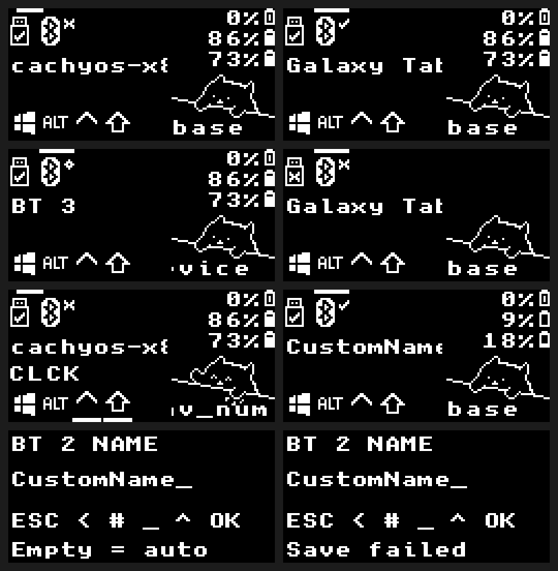
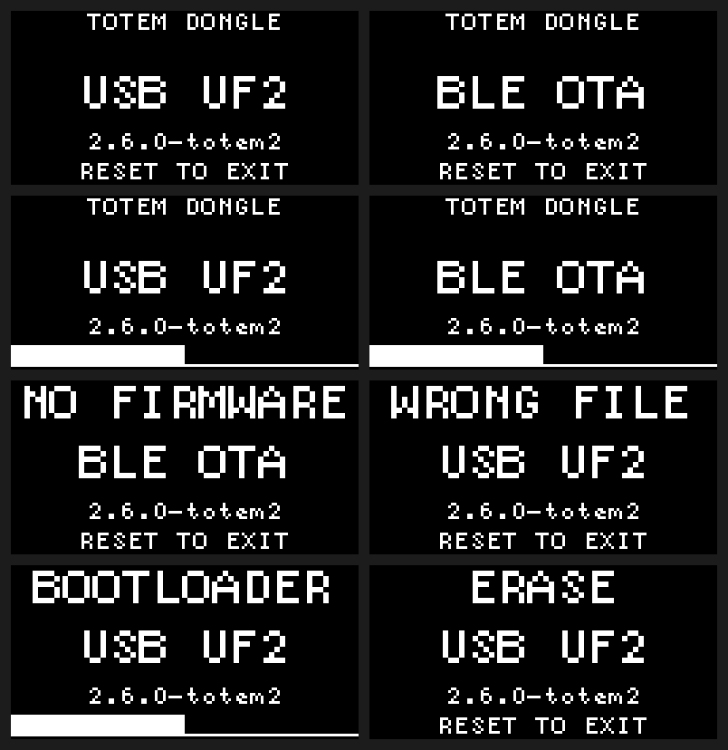

# TOTEM

[English](README.md) | 한국어

TOTEM 키보드용 ZMK 펌웨어 저장소입니다. 옵션으로 OLED 동글, 블루투스 OTA 부트로더, 블루투스 호스트 이름 표시 및 편집을 지원합니다.

## 키맵 및 페어링

[`config/totem.keymap`](config/totem.keymap)을 수정하면 GitHub Actions가 키맵 다이어그램을 자동으로 갱신합니다.



- **동글 페어링**: 동글을 사용할 경우, 좌·우 하프는 동글에 자동 연결됩니다. 블루투스로 입력할 때만 호스트 기기에서 `TOTEM-Dongle`을 페어링하면 되며, USB 유선 연결 시에는 별도 페어링이 필요 없습니다.
- **프로필 관리**: 동글은 최대 5개의 호스트 프로필을 지원합니다. BT1~5 버튼으로 페어링된 기기 바꿀 수 있고 `BT_CLR` 키로 저장된 페어링 삭제할 수 있습니다.

## 빌드

미리 빌드된 UF2 파일과 OTA ZIP 패키지는 [GitHub Actions](https://github.com/80ROkWOC4j/totem/actions) 실행 결과의 **Artifacts**에서 내려받을 수 있습니다.

로컬 빌드는 devcontainer 구성되어 있어 `"dev.containers.dockerPath": "podman"` 설정 하면 간단하게 할 수 있습니다.

```sh
./scripts/container.sh ./scripts/setup.sh
./scripts/container.sh python3 scripts/build.py all
./scripts/container.sh python3 scripts/build-bootloader.py all
```

특정 타깃만 빌드하려면 `all` 대신 타깃 이름을 지정합니다:

- **펌웨어** ([`build.yaml`](build.yaml)): `totem_dongle_central_oled`, `totem_dongle_left`, `totem_dongle_right`(동글 사용) 또는 `totem_left`, `totem_right`(단독 사용)
- **부트로더**: `totem_dongle`, `totem_left_ble`, `totem_right_ble`, `totem_left_ble_sense`, `totem_right_ble_sense`

결과물은 `build/artifacts/`(부트로더는 `build/artifacts/bootloader/`)에 생성됩니다.

### 자동 빌드와 다운로드

다운로드는 **firmware-uf2**(USB 설치용)와 **firmware-ota**(폰 OTA용)로
분리됩니다. 부트로더는 **bootloader-uf2**에서 받습니다. 수동 전체 빌드는
HEX·메타데이터·미리보기를 **firmware-recovery**, **bootloader-recovery**로
별도 제공하며 설치 파일을 중복 포함하지 않습니다. 전체 빌드 UF2는 원래
빌드 파일명을 유지합니다. 부트로더 OTA를 준비할 때는 해당 recovery와 UF2
압축파일을 같은 로컬 artifacts 폴더에 풀어 사용하세요.


문서·이미지·키맵 그림만 바꾸면 펌웨어 빌드를 생략합니다. 키맵·레이아웃
변경은 대표 타깃 2종(단독 왼쪽·OLED 동글)만, 펌웨어·설정·의존성 변경은
전체 펌웨어를 빌드합니다. 부트로더 관련 변경은 부트로더 5종을 별도로
빌드하고, 공통 도구나 분류되지 않은 빌드 입력 변경은 양쪽을 빌드합니다.
새 브랜치는 `main`과의 공통 조상부터 비교합니다.

자동 다운로드는 **7일 보관**하며 UF2·애플리케이션 OTA ZIP만 포함합니다
(부트로더 다운로드는 UF2만). 수동 다운로드는 **30일 보관**합니다.
**Build All Firmware**는 부트로더도 빌드하고, 복구에 필요한 HEX·메타데이터·
의존성 잠금 파일과 OLED 미리보기까지 포함합니다. 단일 타깃 수동 빌드는
최소 구성입니다. 기존 다운로드의 만료일은 그대로 유지됩니다.

| 대상 | 애플리케이션 OTA 파일 |
| --- | --- |
| 동글 | `dongle-ota.zip` |
| 동글용 왼쪽 / 오른쪽 | `left-ota.zip` / `right-ota.zip` |
| 단독 왼쪽 / 오른쪽 | `left-solo-ota.zip` / `right-solo-ota.zip` |

최소 다운로드의 UF2도 `left.uf2`, `left-solo.uf2`처럼 짧은 이름을 씁니다.
부트로더 UF2는 `dongle-boot.uf2`, `left-boot.uf2`, `right-boot.uf2`,
`left-sense-boot.uf2`, `right-sense-boot.uf2`로 구분합니다. 설치된 보드 식별자에
맞춰 선택하세요. 빌드 타깃 이름과 복구용 HEX/JSON 이름은 유지됩니다.
바깥 Actions 압축파일 이름에는 실행 번호와 소스 커밋이 들어갑니다.
폰에서는 같은 이름의 OTA 파일이 섞이지 않도록 버전별 폴더에 보관하세요.

## 부트로더 및 OTA

커스텀 부트로더(`2.6.0-totem2`)는 ZMK 펌웨어와 독립적으로 동작합니다.

| 조작 | 동작 |
| --- | --- |
| **리셋 1회** | 500 ms 후 BLE OTA 모드 진입 (대기 중 리셋 1회 또는 6분간 무입력 시 일반 펌웨어로 복귀) |
| **더블 리셋** (500 ms 이내) | USB UF2 드라이브 모드 진입 |
| **유효한 펌웨어 없이 전원 인가** | USB 데이터 호스트 연결 시 USB UF2 진입(단순 충전기 제외), 미연결 시 BLE OTA 진입 |

동글 OLED에는 부트로더 모드·버전·전송 진행률 또는 `NO FIRMWARE` / `WRONG FILE`이 표시됩니다(좌·우 하프에는 화면 없음). 전송이 중단되면 이전 이미지로 롤백되지 않으므로 처음부터 다시 전송해야 합니다.

### 1. 최초 USB 부트로더 설치

플래싱 전에 반드시 `INFO_UF2.TXT`, USB VID:PID, SoftDevice 버전을 대조하세요. 일반 XIAO 보드에 Sense 부트로더가 설치되어 출고되는 경우가 있으므로 기판 인쇄명이 아닌 **설치된 `INFO_UF2.TXT` 식별자**를 기준으로 맞추세요.

| 설치된 `INFO_UF2.TXT` (`VID:PID`) | 부트로더 타깃 | SoftDevice |
| --- | --- | --- |
| `nRF52840-nicenano` (`239a:00b3`) | `totem_dongle` | S140 6.1.1 |
| `nRF52840-SeeedXiao-v1` (`2886:0044`) | `totem_left_ble` / `totem_right_ble` | S140 7.3.0 |
| `Seeed_XIAO_nRF52840_Sense` 또는 `nRF52840-SeeedXiaoSense-v1` (`2886:0045`) | `totem_left_ble_sense` / `totem_right_ble_sense` | S140 7.3.0 |

1. 기기를 하나씩 USB로 연결하고 버튼을 두번 눌러서 플래시 준비.
2. 드라이브에 `update-<target>_bootloader-2.6.0-totem2_nosd.uf2`를 드래그 앤 드랍.
3. 재부팅 후 다시 더블 리셋하여 `INFO_UF2.TXT`에 `2.6.0-totem2`가 표시되는지 확인한 뒤, 실제 zmk 펌웨어 `<firmware>.uf2`를 설치.

### 2. Android BLE OTA 업데이트

Nordic [nRF Device Firmware Update](https://play.google.com/store/apps/details?id=no.nordicsemi.android.dfu) 앱을 설치하고 설정에서 **Packets Receipt Notifications (PRN) = 켜기(12)**, **Request high MTU = 끄기**로 맞춥니다. `*-ota.zip` 파일은 압축을 풀지 않고 휴대폰으로 옮깁니다.

| 기기 | BLE OTA 이름 | 동글 펌웨어 타깃 | 단독 펌웨어 타깃 |
| --- | --- | --- | --- |
| 동글 | `TOTEM_DFU` | `totem_dongle_central_oled` | — |
| 좌측 | `TOTEM_L_DFU` | `totem_dongle_left` | `totem_left` |
| 우측 | `TOTEM_R_DFU` | `totem_dongle_right` | `totem_right` |

업데이트할 기기에서 리셋을 1회 누르고 DFU 앱에서 해당 OTA 이름을 선택한 뒤(OS 블루투스 설정에서는 페어링하지 마세요) 맞는 `<firmware>-ota.zip`을 전송합니다. 각 기기는 개별적으로 업데이트하며, 좌·우 하프는 하드웨어 ID가 같아 잘못된 파일을 걸러내지 못하므로 파일명을 꼭 확인하세요.

### 3. BLE로 부트로더 업데이트 (2회 연속 전송)

BLE로 부트로더를 올리면 펌웨어 영역 일부가 덮어써지므로 **부트로더를 OTA로 업데이트 할 경우 펌웨어도 재설치**해야 합니다:

```sh
./scripts/container.sh python3 scripts/bootloader-ota.py totem_right_ble_sense \
  --application-hex build/artifacts/totem_dongle_right.hex
```

`build/bootloader-ota/<target>/`에 생성된 `<device>-01-boot.zip`을 전송하고, DFU 모드로 재부팅되면 다시 스캔하여 `<device>-02-app.zip`을 전송합니다.

## OLED 및 블루투스 호스트 이름

동글 OLED는 선택된 블루투스 프로필에 대해 **`저장된 별칭 → 자동 호스트 이름 → BT 1 … BT 5`** 순서로 이름을 표시합니다(USB 출력 중에도 선택된 프로필 기준으로 표시). 이름은 **영문 ASCII 최대 24자**를 지원하며, 길면 스크롤되고 한글 등 미지원 문자는 `?`로 표시됩니다. 이름과 별칭은 전원을 껐다 켜도 유지되며 `BT_CLR` 실행 시 삭제됩니다.

### 키보드에서 별칭 직접 편집

OLED 동글과 페어링된 프로필이 필요합니다(호스트가 오프라인이어도 가능):

1. `DEVICE` 레이어에서 편집할 프로필을 선택하고 모든 키에서 손을 뗍니다.
2. 양쪽 레이어 엄지 키를 누른 채 **`Q`(`BT name`)를 0.8초 이상 홀드**한 뒤 모든 키를 떼면 `BT n NAME` 편집 화면이 열립니다(ZMK Studio로 키맵을 덮어쓴 경우 `Edit BT host name (hold)`를 할당).
3. OS 언어/키맵과 무관하게 물리 QWERTY 배열로 입력합니다(좌측 끝 Ctrl 위치는 `-`/`_`, 빈 값으로 저장 시 자동 이름 복원, 60초 무입력 시 취소):

| 엄지 키 (좌 → 우) | 편집 기능 | OLED 표시 |
| --- | --- | --- |
| Left GUI | 취소 | `ESC` |
| Symbol 레이어 | 백스페이스 | `<` |
| Navigation 레이어 (홀드) | 상단열 숫자 `1–0` | `#` |
| Space | 공백 | `_` |
| Right Shift (홀드) | 대문자 / `_` | `^` |
| Right Alt | 저장 | `OK` |





위 미리보기는 펌웨어 렌더링 코드로 생성한 이미지입니다. 빌드 시 `images/`가 갱신되고 `build/artifacts/` 아래에 전체 PNG 세트가 포함됩니다(단독 추출: `python3 scripts/export-oled.py`, `python3 scripts/export-status-oled.py`).

## 소스 출처 및 의존성 관리

[`Keycoon/zmk-config-totem`](https://github.com/Keycoon/zmk-config-totem)(`b66b405`)과 [`a741725193/zmk-sofle-dongle`](https://github.com/a741725193/zmk-sofle-dongle)(`d3f2f76`)의 Totem/동글 설정을 병합해 시작했습니다.

| 서브모듈 | 포크 저장소 | 비고 |
| --- | --- | --- |
| `zmk/` | [`80ROkWOC4j/zmk`](https://github.com/80ROkWOC4j/zmk) | ZMK 0.3 / Zephyr 3.5 + 배터리 커브(`f181b36`) + 호스트 이름 훅(로컬 모듈 `firmware/host-names/`) |
| `zmk-dongle-display/` | [`80ROkWOC4j/zmk-dongle-display`](https://github.com/80ROkWOC4j/zmk-dongle-display) | 업스트림 v0.3(`c6c4be1`) + 이름 위젯 훅 |
| `bootloader/` | [`80ROkWOC4j/nRF52_Bootloader`](https://github.com/80ROkWOC4j/nRF52_Bootloader) | [`meshtastic/nRF52_Bootloader` 2.6.0](https://github.com/meshtastic/nRF52_Bootloader/releases/tag/2.6.0)(`e75ad3f`, ARM GCC `12.3.Rel1`) 포크, Adafruit `nice_nano` 0.6.0 및 Seeed XIAO 보드 정의(`bootloader-config/LICENSE.upstream`), `0x20008010` NOLOAD RAM 기반 단일 리셋 OTA 정책 적용 |

### 상세 제품 정보
- `Keycoon/zmk-config-totem`
  - store: https://aliexpress.com/item/1005009718551409.html
  - doc: https://suns-shave-80u.craft.me/NDKH6lhuW8BzBi
  - repo: https://github.com/Keycoon/zmk-config-totem
  - base commit: `b66b405ff4aef822955360d705966ebfa996ea2c`
- `a741725193/zmk-sofle-dongle`
  - store: https://aliexpress.com/item/1005011640674919.html
  - doc: https://ae-pic-a1.aliexpress-media.com/kf/Se2ead0612b7448f2b4678e32ee36c0ecD.pdf
  - repo: https://github.com/a741725193/zmk-sofle-dongle
  - base commit: `d3f2f764d5324af0dbac1a680fabf33d930e6026`

### 의존성 업데이트

1. 포크 저장소에 변경 사항을 푸시한 뒤 새 커밋을 스테이징합니다(`git add zmk`, `zmk-dongle-display`, 또는 `bootloader`). `zmk/` 베이스 변경 시 배터리 커브 커스터마이징을 유지하세요.
2. `bootloader/` 업데이트 시 [`bootloader-config/source.json`](bootloader-config/source.json)의 `revision`과 `version`도 함께 맞춥니다.
3. [`config/west.lock.yml`](config/west.lock.yml)은 Zephyr 및 하위 west 모듈만 고정합니다. ZMK의 `app/west.yml`이 변경되면 [`config/west.yml`](config/west.yml)에 반영한 뒤 `./scripts/container.sh` 내부에서 잠금 파일을 갱신합니다:

```sh
west config manifest.file west.yml
west update --fetch-opt=--filter=tree:0
python3 scripts/freeze.py
west config manifest.file west.lock.yml
./scripts/setup.sh
```
