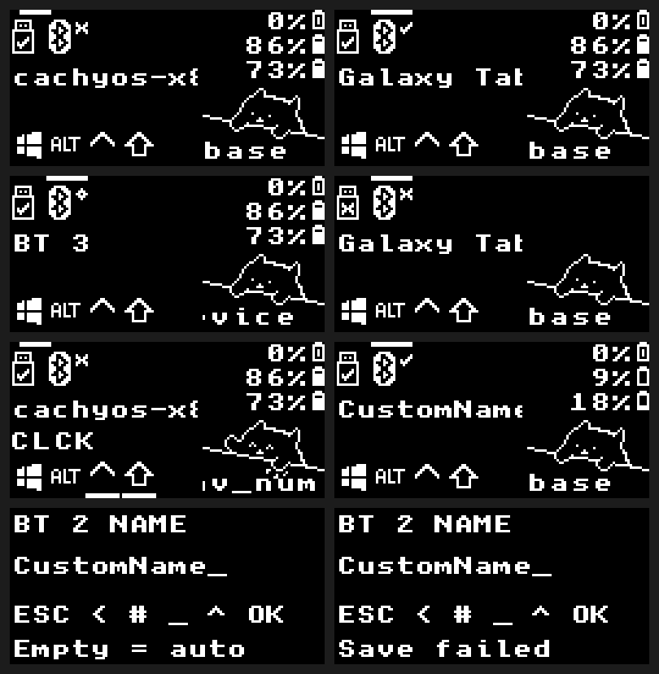

# TOTEM

ZMK firmware for TOTEM keyboards, with optional OLED dongle, Bluetooth OTA
and host-name display.

## Keymap

Edit [the keymap](config/totem.keymap); the diagram updates through GitHub Actions.
Device-side ZMK Studio edits are not shown here.


## Build

Requires rootless Podman on Linux x86-64.

```sh
./scripts/container.sh ./scripts/setup.sh
./scripts/container.sh python3 scripts/build.py all
```

Replace `all` with an `artifact-name` from [build.yaml](build.yaml) to build one target:

- With dongle: `totem_dongle_central_oled`, `totem_dongle_left`, `totem_dongle_right`.
- Without dongle: `totem_left`, `totem_right`.

UF2 files and OTA ZIPs are written to `build/artifacts/`. These commands do not flash devices.
Prebuilt files are available in completed [GitHub Actions runs](https://github.com/80ROkWOC4j/totem/actions/workflows/build-all.yml)
under **Artifacts**.

Setup initializes pinned fork submodules and west dependencies.
See [UPSTREAM.md](UPSTREAM.md) for sources and dependency updates.
For VS Code Dev Containers, set `"dev.containers.dockerPath": "podman"` and reopen in the container.

## Bootloader and OTA

The custom bootloader provides single-reset BLE OTA, double-reset USB UF2,
and mode/progress display on the dongle OLED.

```sh
./scripts/container.sh python3 scripts/build-bootloader.py all
```

Follow the [OTA guide](docs/OTA.md) for board matching, initial USB installation
and Android transfers. Bootloader OTA requires **two transfers**: the bootloader,
then the matching application.

## OLED previews

The connection screen shows automatic Bluetooth host names or saved aliases.
Hold both layer thumbs, then hold `BT name` for 0.8 seconds and release all keys
to edit an alias. See [host-name controls and limits](docs/HOST-NAMES.md).




These examples are rendered from firmware drawing code. Builds refresh the
README snapshots in `docs/images/` and include full image bundles in their artifacts.
See [OLED export details](docs/OTA.md#export-oled-screens).
