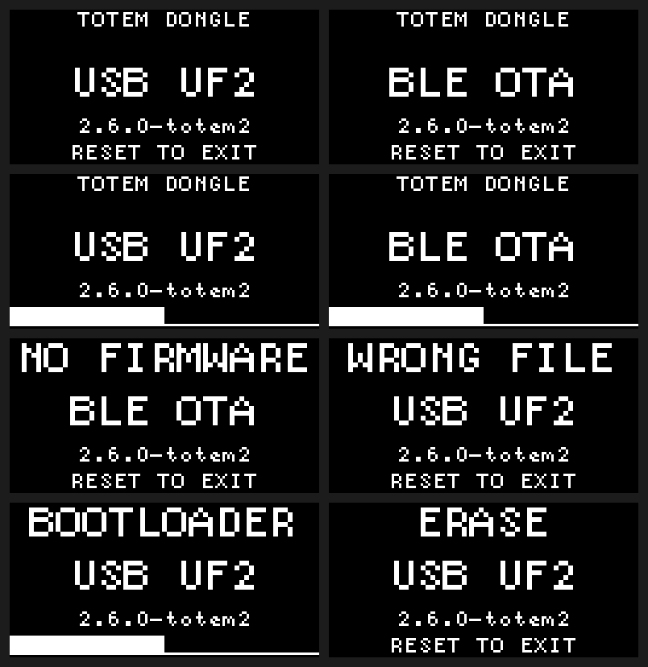

# TOTEM

English | [한국어](README.ko.md)

ZMK firmware repository for TOTEM keyboards, with optional OLED dongle, Bluetooth OTA bootloader, and Bluetooth host-name display/editing.

## Keymap & Pairing

Edit [`config/totem.keymap`](config/totem.keymap); GitHub Actions updates the keymap diagram automatically. See [KEYMAP.md](KEYMAP.md) for this branch's independent half layers and home-row modifiers. Device-side ZMK Studio edits are not shown in the diagram.



- **Dongle pairing**: When using a dongle, the left and right halves connect to it automatically. Pair `TOTEM-Dongle` on the host only for Bluetooth typing; wired USB needs no pairing.
- **Profiles**: The dongle supports up to 5 host profiles. Switch paired devices with `BT 1`–`BT 5` and clear a saved pairing with `BT_CLR`.

## Build

Prebuilt UF2 files and OTA ZIPs are available under **Artifacts** in [GitHub Actions](https://github.com/80ROkWOC4j/totem/actions).

A Dev Container is configured for local builds—set `"dev.containers.dockerPath": "podman"` to build easily:

```sh
./scripts/container.sh ./scripts/setup.sh
./scripts/container.sh python3 scripts/build.py all
./scripts/container.sh python3 scripts/build-bootloader.py all
```

Replace `all` with a target name to build a single target:

- **Firmware** ([`build.yaml`](build.yaml)): `totem_dongle_central_oled`, `totem_dongle_left`, `totem_dongle_right` (with dongle) or `totem_left`, `totem_right` (standalone)
- **Bootloader**: `totem_dongle`, `totem_left_ble`, `totem_right_ble`, `totem_left_ble_sense`, `totem_right_ble_sense`

Outputs are generated in `build/artifacts/` (and `build/artifacts/bootloader/` for bootloaders).

### CI builds and downloads

| Artifact prefix | Contents | When available |
| --- | --- | --- |
| `firmware-uf2` | Application UF2 files for USB installation | Firmware builds |
| `firmware-ota` | Application OTA ZIPs for the phone | Firmware builds |
| `bootloader-uf2` | Bootloader UF2 files for USB installation | Bootloader builds |
| `bootloader-ota` | Bootloader update + application restore ZIP pairs, instructions and validation metadata | Bootloader builds |
| `firmware-recovery` | Application HEX, build metadata, source lock and OLED previews | Manual full builds |
| `bootloader-recovery` | Bootloader HEX, build metadata and OLED previews | Manual full builds |

Only artifacts needed for that run are published. Automatic downloads are kept
for **7 days**; manual downloads for **30 days**. Names include the workflow's
archive label, run number and source commit. Existing downloads keep their original
expiry dates. Keep different builds in separate phone folders.

For all six artifacts, open **Actions → Build All Firmware → Run workflow**, choose
`main` or `home-row`, then run it. The selected branch determines the keymap in the
application and in the bootloader OTA restore packages. **Build Left Firmware**
and **Build Dongle Central** produce only that target's application UF2 and OTA.

Automatic build scope:

- Documentation, images and drawing-only changes: no firmware or bootloader build.
- Keymap/layout changes: two representative targets (standalone left and OLED dongle).
- Firmware/configuration dependencies: all five firmware targets.
- Bootloader changes: five bootloaders and three dongle-configuration application
  targets needed for OTA restoration; only bootloader artifacts are published if
  there are no independent firmware changes.
- Shared tooling or unclassified build inputs: both firmware and bootloader builds.

Targets selected by both paths are built once. New branches are compared with
their merge base on `main`.

| Device | Application OTA file |
| --- | --- |
| Dongle | `dongle-ota.zip` |
| Left / right with dongle | `left-ota.zip` / `right-ota.zip` |
| Left / right standalone | `left-solo-ota.zip` / `right-solo-ota.zip` |

Automatic and single-target manual downloads use short UF2 names such as `left.uf2`
and `left-solo.uf2`. Bootloader names are `dongle-boot.uf2`, `left-boot.uf2`,
`right-boot.uf2`, `left-sense-boot.uf2` and `right-sense-boot.uf2`.
**Manual full builds retain the original UF2 names**, such as `totem_dongle_left.uf2`
and `update-totem_right_ble_sense_bootloader-2.6.0-totem2_nosd.uf2`.
OTA ZIP names stay short in every build.

The ready-made `bootloader-ota` bundle needs no recovery archive. To regenerate
packages locally using a manual full build, extract `firmware-uf2` and
`firmware-recovery` into `build/artifacts/`, and `bootloader-uf2` and
`bootloader-recovery` into `build/artifacts/bootloader/`, from the same run.
Use the matching repository commit so source-lock validation agrees.

## Bootloader & OTA

The custom bootloader (`2.6.0-totem2`) runs independently of the ZMK firmware.

| Action | Behavior |
| --- | --- |
| **Single reset** | Enter BLE OTA after 500 ms (reset once again or wait 6 min idle to return to firmware) |
| **Double reset** (< 500 ms) | Enter USB UF2 drive mode |
| **Power on without valid firmware** | USB UF2 if attached to a USB data host (not a charger), otherwise BLE OTA |

The dongle OLED shows bootloader mode, version, upload progress, or `NO FIRMWARE` / `WRONG FILE` (halves have no display). Interrupted transfers have no rollback—restart the transfer from the beginning.

### 1. Initial USB Bootloader Installation

Match `INFO_UF2.TXT`, USB VID:PID, and SoftDevice version before flashing. Some non-Sense XIAO boards ship with a Sense bootloader—match the **installed `INFO_UF2.TXT` identity**, not the printed board name.

| Installed `INFO_UF2.TXT` (`VID:PID`) | Bootloader target | SoftDevice |
| --- | --- | --- |
| `nRF52840-nicenano` (`239a:00b3`) | `totem_dongle` | S140 6.1.1 |
| `nRF52840-SeeedXiao-v1` (`2886:0044`) | `totem_left_ble` / `totem_right_ble` | S140 7.3.0 |
| `Seeed_XIAO_nRF52840_Sense` or `nRF52840-SeeedXiaoSense-v1` (`2886:0045`) | `totem_left_ble_sense` / `totem_right_ble_sense` | S140 7.3.0 |

1. Connect one device at a time over USB and double-press reset to prepare for flashing.
2. Extract `bootloader-uf2` and copy the matching file onto the drive: `<device>-boot.uf2` from an automatic build, or `update-<target>_bootloader-2.6.0-totem2_nosd.uf2` from a manual full/local build.
3. After reboot, double-reset again to confirm `2.6.0-totem2` in `INFO_UF2.TXT`, then install the ZMK firmware `<firmware>.uf2`.

### 2. Android BLE OTA Update

Install Nordic [nRF Device Firmware Update](https://play.google.com/store/apps/details?id=no.nordicsemi.android.dfu) and set **Packets Receipt Notifications (PRN) = ON (12)** and **Request high MTU = OFF**. Extract the outer `firmware-ota` download, then copy the matching inner `*-ota.zip` to the phone without extracting that ZIP.

| Device | BLE OTA name | With dongle | Standalone |
| --- | --- | --- | --- |
| Dongle | `TOTEM_DFU` | `dongle-ota.zip` | — |
| Left | `TOTEM_L_DFU` | `left-ota.zip` | `left-solo-ota.zip` |
| Right | `TOTEM_R_DFU` | `right-ota.zip` | `right-solo-ota.zip` |

Press reset once on the target device, select its BLE OTA name in the DFU app (do not pair OTA names in OS Bluetooth settings), and upload the matching `<firmware>-ota.zip`. Update each device separately; left and right halves share hardware IDs and cannot reject a file meant for the other side, so double-check the filename.

### 3. Bootloader Update over BLE (Two Sequential Transfers)

CI publishes **bootloader-ota** whenever bootloaders are built (7 days for automatic
builds, 30 days for manual builds). Extract the outer download on your phone;
choose `dongle`, `left`, `left-sense`, `right` or `right-sense` according to the
installed board identity. Each folder contains `*-01-boot.zip`, `*-02-app.zip`,
`README.txt` and a validation manifest. Transfer 01, reconnect, then transfer 02;
keep the two inner ZIPs intact. These restore **dongle-configuration firmware**,
not the standalone layout. Both packages come from the same CI checkout.

To generate all five pairs locally after building firmware and bootloaders:

```sh
./scripts/container.sh python3 scripts/bootloader-ota.py all
```

Updating the bootloader over BLE overwrites part of the firmware region, so **you must also reinstall the firmware when updating the bootloader over OTA**:

```sh
./scripts/container.sh python3 scripts/bootloader-ota.py totem_right_ble_sense \
  --application-hex build/artifacts/totem_dongle_right.hex
```

The `all` command writes to `build/bootloader-ota/all/<device>/`; a single-target command writes to `build/bootloader-ota/<target>/`. Upload `<device>-01-boot.zip`, wait for the device to reboot into DFU mode, rescan, and upload `<device>-02-app.zip`.

## OLED & Bluetooth Host Names

The dongle OLED displays names for the selected Bluetooth profile in the order **`saved alias → automatic host name → BT 1 … BT 5`** (shown for the selected profile even while USB output is active). Names support up to **24 ASCII characters** (scrolling if longer; unsupported characters such as Korean appear as `?`). Names and aliases persist across power cycles and clear on `BT_CLR`.

### Editing an Alias on the Keyboard

Requires the OLED dongle and a paired profile (host may be offline):

1. Select the profile on the `DEVICE` layer and release all keys.
2. Chord the left outer and middle thumbs (`L_AUX` + `L_FN`) within 50 ms and keep both held to open `DEVICE`, hold **`R` (`BT name`) for ≥ 0.8 s**, then release all keys to open `BT n NAME` (if overridden in ZMK Studio, bind `Edit BT host name (hold)`).
3. Type using physical QWERTY positions regardless of OS language/keymap (`-`/`_` on outer left Shift; saving empty restores automatic naming; 60 s idle cancels):

| Thumb key (left → right) | Editor action | OLED |
| --- | --- | --- |
| L_AUX | Cancel | `ESC` |
| L_FN | Backspace | `<` |
| Space (hold) | Top-row digits `1–0` | `#` |
| Enter / R_NUM | Space | `_` |
| Tab / R_NAV (hold) | Uppercase / `_` | `^` |
| Backspace | Save | `OK` |




Previews above are rendered from firmware drawing code. Default local builds refresh `images/` and write full PNG sets under `build/artifacts/`. In CI, only manual full builds generate previews, included in the recovery artifacts (standalone export: `python3 scripts/export-oled.py` and `python3 scripts/export-status-oled.py`).

## Sources & Dependency Maintenance

Started by merging Totem/dongle configurations from [`Keycoon/zmk-config-totem`](https://github.com/Keycoon/zmk-config-totem) (`b66b405`) and [`a741725193/zmk-sofle-dongle`](https://github.com/a741725193/zmk-sofle-dongle) (`d3f2f76`).

| Submodule | Fork | Notes |
| --- | --- | --- |
| `zmk/` | [`80ROkWOC4j/zmk`](https://github.com/80ROkWOC4j/zmk) | ZMK 0.3 / Zephyr 3.5 + battery curve (`f181b36`) + host-name hooks (local module `firmware/host-names/`) |
| `zmk-dongle-display/` | [`80ROkWOC4j/zmk-dongle-display`](https://github.com/80ROkWOC4j/zmk-dongle-display) | Upstream v0.3 (`c6c4be1`) + name-widget hook |
| `bootloader/` | [`80ROkWOC4j/nRF52_Bootloader`](https://github.com/80ROkWOC4j/nRF52_Bootloader) | Forked from [`meshtastic/nRF52_Bootloader` 2.6.0](https://github.com/meshtastic/nRF52_Bootloader/releases/tag/2.6.0) (`e75ad3f`, ARM GCC `12.3.Rel1`), Adafruit `nice_nano` 0.6.0 & Seeed XIAO board defs (`bootloader-config/LICENSE.upstream`), single-reset OTA policy via NOLOAD RAM at `0x20008010` |

### Product Details
- `Keycoon/zmk-config-totem`
  - store: https://aliexpress.com/item/1005009718551409.html
  - doc: https://suns-shave-80u.craft.me/NDKH6lhuW8BzBi
  - repo: https://github.com/Keycoon/zmk-config-totem
  - base commit: `b66b405ff4aef822955360d705966ebfa996ea2c`
- `a741725193/zmk-sofle-dongle`
  - store: https://aliexpress.com/item/1005011640674919.html
  - doc: https://ae-pic-a1.aliexpress-media.com/kf/Se2ead0612b7448f2b4678e32ee36c0ecD.pdf
  - repo: https://github.com/a741725193/zmk-sofle-dongle
  - base commit: `d3f2f764d5324af0dbac1a680fabf33d930e6026`

### Updating Dependencies

1. Push changes to the fork, then stage the new commit (`git add zmk`, `zmk-dongle-display`, or `bootloader`). Preserve the battery-curve customization when changing the `zmk/` base.
2. When updating `bootloader/`, also update `revision` and `version` in [`bootloader-config/source.json`](bootloader-config/source.json).
3. [`config/west.lock.yml`](config/west.lock.yml) pins only Zephyr and transitive west modules. If ZMK's `app/west.yml` changes, reflect it in [`config/west.yml`](config/west.yml) and refresh the lock inside `./scripts/container.sh`:

```sh
west config manifest.file west.yml
west update --fetch-opt=--filter=tree:0
python3 scripts/freeze.py
west config manifest.file west.lock.yml
./scripts/setup.sh
```
